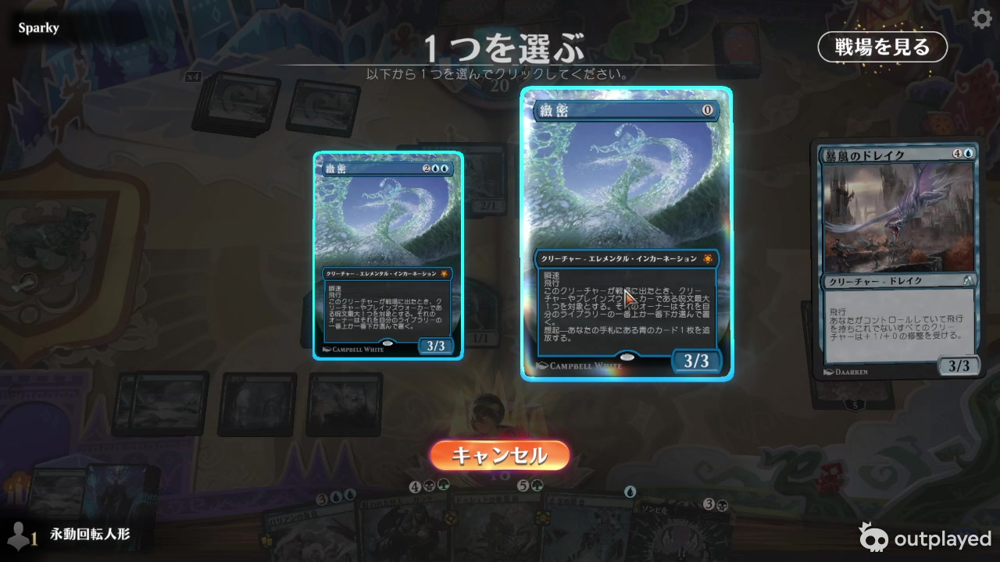
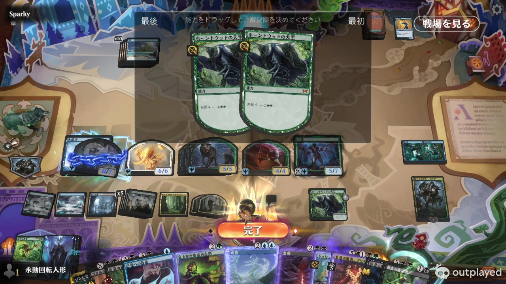
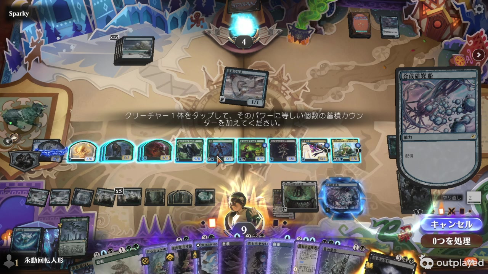
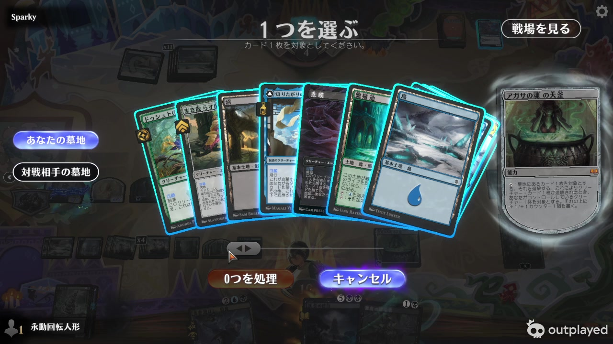
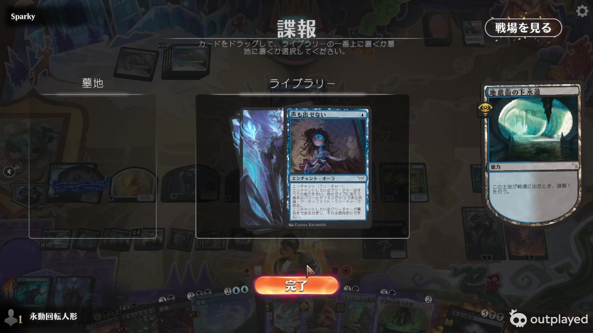
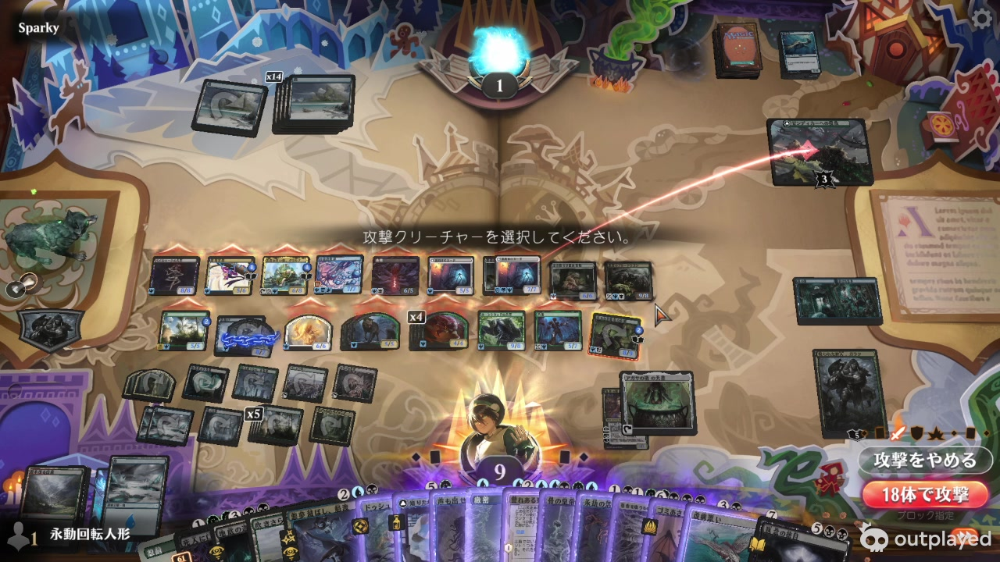

# MTGA 录屏详细参考分析 · 2026-09-27

## 1. 结论与使用边界

这段录屏最有价值的是**同一套视觉语言如何表达不同决策阶段**：选择施放方式、支付费用、选择目标、排列诱发、让过、结算，各有明确的来源、候选对象和完成动作。不能把它们都画成一个“选择能力”的文字列表。

用户已确认：**现有卡组选卡保留，不要求照搬 Arena 的扇形卡列**。复用当前网格、分页、候选优先、不可选变暗、已选边框、确认和重选；参考录像补流程、来源提示和状态反馈。搜证等未拍到的机制可以类推界面，但必须分别校验完成条件。

以下区分三类内容：

- **实见**：从此次视频抽帧中能直接确认的画面或状态变化。
- **现有代码**：2026-09-27 对指定源文件的静态检查，不能替代双端运行验证。
- **建议／待验**：MTGB 应采用的交互或验收要求，不声称视频已经证明、程序已经完成。

第 1–6 节是早期抽样参考记录；后续实现见第 7–9 节。完整时间范围的审查、剩余差异与本轮验证见 [整段录像对照与验收](ArenaFullReview-2026-09-27.zh-CN.md)，不能将早期抽样结论当成全部通过。

### 源视频与检查方法

- 用户目录：`C:\Users\Sam\Videos\Overwolf\Outplayed\MTG Arena\MTG Arena_09-27-2026_7-34-1-962`
- 实际视频：`MTG Arena_09-27-2026_7-56-40-333.mp4`
- 时长 **22:25.386**；分辨率 **1280×720**；帧率 **30 fps**。
- 先用每 10 秒一帧的 135 张缩略图覆盖全片，再对五段重要流程按每秒一帧检查，共 110 张；另外提取 21 张原分辨率关键帧。不是实时连续播放，也未据此测定亚秒级动画时长或鼠标按键。
- 加密检查：01:40–02:00、11:24–12:04、15:28–15:43、16:29–16:49、21:09–21:24。
- 可复查原帧和部分连续对照图保存于 `Docs/References/Arena-2026-09-27/`。临时全片索引及提取脚本在 `.tools/arena-audit-0927/`。
- 时间点用于定位，可前后移动 1–2 秒观察上下文。末尾约 22:15 为等待服务器画面，22:25 为录制暂停；不能用这段末尾判断 MTGB 对局结束表现。

## 2. 可直接回看的时间索引

| 时间 | 实见内容 | 对 MTGB 的参考价值 |
| --- | --- | --- |
| 00:25 附近 | 对局起始手牌和战场 | 仅能定位开局；没有覆盖双方反复调度的完整验证 |
| 01:40–01:59 | 对方咒语在右；Subtlety 的普通施放／呼魂两张候选卡居中；打开、退出、再次打开 | 右侧在途咒语不是第三个选项；候选和背景堆叠必须分区 |
| 02:45 附近 | Grist 的三个忠诚异能以三张独立异能牌展示 | 每项自己的费用、效果及可用状态，悬停放大 |
| 02:55 | 单纯浏览墓地，底部“完成” | 浏览不能误提交规则动作；与强制选牌分开 |
| 03:35–03:45 | 异能处理后，场上出现蓝色锁链状态 | 状态附着在对应永久物上；不能只靠操作区文字 |
| 04:45–05:05 | 房间牌施放／进入战场，非生物区域出现横向房间牌 | 特殊牌框不能都套用普通生物裁图 |
| 06:25–06:35 | 在原手牌区域选择弃牌，中央说明，右下完成计数 | 手牌费用／弃牌未必需要另开全屏卡库 |
| 07:05 | Dusyut Earthcarver 的闘魂 3：中央两个异能选项；右侧保留来源异能 | 模式选项不是两段长文字；右侧来源不是第三项 |
| 08:55–09:05 | 两个同源异能排序，顶部标明左“最后”、右“最先” | 同源异能不能按卡名合并；顺序方向必须直观 |
| 10:35 | Consign to Memory 选择堆叠对象；候选含异能和咒语；悬停出现“复制”说明 | 堆叠目标不只是一张战场卡；需要对象级身份 |
| 11:24–11:30 | 结算中从展示卡列选择，右侧来源持续可见，存在“拒绝” | 跳过可选效果与取消正在施放的动作不是同一含义 |
| 11:34–11:38 | 刺探：左右目的区，卡在牌库／墓地之间移动，最后完成 | 去向可以修改，提交与改选是两个阶段 |
| 11:40–11:47 | Grief 选择呼魂，随后在手牌中选黑牌支付，完成后进入战场 | 施放方式、替代费用选牌、咒语结算需要连续串联 |
| 11:48–11:56 | Grief 相关多个诱发进入排序，再在右侧错位堆叠；随后永久物离场 | 同源多个异能分别显示；来源离场不应令异能图像消失 |
| 11:58–12:03 | 前兆／普通施放选项，随后 X 数值界面和支付 | 单选方式、数值输入不能混成通用选卡 |
| 12:55 | Psychic Frog 从墓地选三张牌放逐，有选择数量、取消和完成入口 | 可复用现有多选；这是“张数”费用，不能当成搜证的法术力值费用 |
| 13:35 | 玩家目标选择：中央说明、指向头像的蓝色弧线、右下处理与返回操作 | 玩家头像也是目标；弧线必须有明确来源和终点 |
| 14:15–14:25 | 长卡列横向浏览 | 翻页／滚动是浏览，不应使来源和确认状态丢失 |
| 15:28–15:39 | Agatha's Soul Cauldron 选墓地牌，左侧“你的墓地／对手墓地”入口 | 多区域候选要明确归属；不能把两边同名牌混成一个对象 |
| 16:15 | 卡牌悬停旁有独立关键词／状态解释 | 大图和解释放在对象旁边，避免全堆到牌面上 |
| 16:34–16:37 | 载具配备费用：选生物横置，场上候选描边，右下取消／完成 | 选择用于支付费用的生物，不等同于指定它为目标 |
| 16:42–16:46 | 诱发排序后选己方非地神器，来源在右、蓝色弧线连向场上对象 | 费用完成→诱发排序→目标选择是不同阶段 |
| 17:05 | 同一 Grief 出现普通施放与“回顾”方式；详情注明回顾 | 可用方式来自当前状态，不能按卡牌印刷名称写死菜单 |
| 20:15 | 费用说明居中，产费来源金色高亮，右下取消／自动支付 | 参考支付反馈；**不恢复 MTGB 用户已否决的独立自动支付按钮** |
| 21:10–21:20 | 全体攻击、减少／恢复攻击者、选择旅法师作为受攻击对象、确认 | 数量随选择更新，声明前可修改；红色方向线与蓝色法术目标线区分 |
| 21:21–21:23 | 攻击声明后出现多个诱发排序，再进入右侧堆叠 | 不能让攻击动画越过必须处理的诱发决策 |

## 3. 各类交互的具体参考

### 3.1 普通施放、呼魂、回顾、忠诚异能、模式选择

**实见：**候选集中在中央，背景适度变暗；候选有卡图、费用和本项效果。悬停只放大当前候选，其余仍可辨认。右侧原有堆叠对象或当前来源保留。01:44 的菜单实际是两个 Subtlety 施放方式，旁边的对方飞龙属于背景堆叠；07:05 同样是两个闘魂结果加一个来源异能。

**建议：**

1. 施放方式用卡牌式选项；异能模式用独立异能卡面，费用独立显示。法术力颜色可以用紧凑符号，不必为每种颜色做巨型卡片。
2. 当前可用方式和费用由引擎提供。像 17:05 的“回顾”可能由其他效果赋予，不能仅检查印刷卡文。
3. 用户已要求的“只有一个合法方式时直接进入下一步”保留；这段录像没有证明所有单选情况都自动跳过，不能冒称来自录像。
4. 菜单可取消时，保留用户指定的外部左／右键取消；取消只撤回当前尚可撤回的动作，不是撤销已经结算的事件。
5. 结算中不可取消的选择不伪造取消；有可选效果时，按钮应表达“跳过／不执行”，不要和“撤回施放”混用。

**呼魂阶段图：**手牌选牌 → 选择施放方式（必要时）→ 选择替代费用用牌 → 确认费用 → 咒语在堆叠上 → 进入战场 → 诱发排序／选目标 → 诱发结算。11:40–11:56 展示了其中多个连续阶段。不能因为费用是放逐牌而让 UI 一下跳到牺牲生物，也不能把支付用牌画成法术目标。

### 3.2 异能堆叠与正在处理的对象

**实见：**咒语使用完整矩形卡；异能使用上部来源插画、下部自身效果、弧形底边。异能框有与来源相关的颜色／材质，不是一块统一深色背景。右侧多项沿斜向轻微转角展开，后项露出可辨认的卡头和边缘；正在处理的一项在前方。发光围绕轮廓，并伴随来源／目标的短暂连线。来源在场上的小卡和堆叠上的异能不是同一个视觉对象。

11:48–11:56 是同源多诱发、排序、进入堆叠、来源离场的连续参考；10:35 则说明咒语及异能都可能成为另一个效果的候选对象。

**建议：**

- 保留 MTGB 已加入的错位叠放、悬停详情和当前顶项流光；继续核对露出宽度、转角、前后层次和小窗口裁切。
- 不恢复“启动异能／诱发异能”的额外大标签，也不恢复“详情”按钮。异能自身卡面保留有用的效果和费用。
- 图像未加载时显示有名字的暗色占位，禁止默认白块；布局尺寸先稳定，再替换纹理。
- 同一来源的不同异能、同一异能的复制品，都按独立堆叠对象标识保存；不能按卡名合并。
- “堆叠顶项”与“引擎正在结算”不是完全同义。前者可能还在等响应；若要改变结算特效，必须有明确状态依据，不能靠 UI 自己计时认定结算。

### 3.3 同时诱发的排序

**实见：**08:55 和 11:48 等处，居中展示多个异能对象，顶端明确“最后／最先”，要求拖动决定结算顺序，底部一次“完成”。同源的多张对象仍分开展示。

**建议：**MTGB 应展示每项对应的来源和实际效果，顺序变更在本地清楚反馈，确认后一次提交。可以保留更简单的移动左右／前后按钮作替代，不要求复制拖动手势，但不能用同名的一列长文字让用户猜“哪个先结算”。打开“查看战场”只能暂时隐藏遮罩，不能丢掉已排好的顺序。

### 3.4 战场目标、玩家目标与费用选牌

**实见：**场上选择时战场保持可见，中间说明当前需要什么；候选有高亮。13:35 的玩家目标连到头像；16:44 的神器目标连到对应永久物。16:34 的配备费用则直接高亮能参与支付的生物。右侧始终提供当前动作的上下文，主操作位于右下。

**MTGB 应保留的明确约定：**

- 可选、不可选、已选有稳定区别；已选不能仅在鼠标悬停时才显现。
- 单目标：点 A 选中，点 A 取消，点 B 改为 B 并取消 A；仍保留确认和重选。
- 多目标：所有已选对象持续可辨；不能只给最后一个对象一根线而隐藏其他选择。
- 选目标、牺牲费用、弃牌费用、横置费用都可以共用点击交互，但提示、限制与撤回范围不同。
- 改选不改变卡位、不重播入场动画、不刷新整个战场；服务器回执等待时防重复提交，当前选择继续显示。
- 录像未提供输入事件日志，不能据此证明任意位置右键的效果。外部取消依用户要求实现，并服从引擎当前可取消状态。

### 3.5 卡库、墓地、放逐区及搜证

**实见：**02:55 是浏览；12:55 是放逐三张墓地牌的费用；15:35 是墓地目标，左右玩家墓地有切换入口。这三种面板虽然都展示卡牌，完成条件并不一样。长卡列浏览过程中来源和操作区保持稳定。

**保留 MTGB 当前方案：**

- 网格／分页布局；能选的排前面，其余变暗；普通卡片下方不增加“可选／已选／选择”字样。
- 点击卡图选中；边框表示已选；最大数量为一时支持替换；面板底部确认／重选。
- 可见但不能选的牌继续允许看详情；已选状态跨分页保留。
- 对方隐藏区域只展示引擎授权可见的数据，不能因为共用选牌面板泄露其他牌。

**搜证的类推：**界面可以复用墓地多选，但应显示“已选法术力值合计 / 需要值”，例如 `5 / 6`，而不是只显示 `已选 2 张`。达到阈值后确认；未达到时不能提交部分费用。官方定义是从自己的墓地放逐任意数量牌，使法术力值总和达到或超过要求值；不是固定张数，也不是恰好相等。[官方机制说明](https://magic.wizards.com/en/news/feature/murders-at-karlov-manor-mechanics)

这一段是规则资料支持的类推，**不是录像里拍到了搜证**。同样，探险、检视若干选一、重排牌库顶、分配伤害等可以复用基础控件，但要分别表达揭示范围、目的区、数量／数值约束及顺序。

### 3.6 刺探／占卜的目的地选择

**实见：**11:34–11:38 中刺探卡先位于牌库区，移到墓地区，完成后收起面板；右侧来源异能始终可见。背景牌库使用牌背，没有展开未被允许查看的牌。

**建议：**保留现有卡图及“置顶／入墓”交互也可以。关键是始终看得出每张牌现在去哪、是否还能修改、同组顺序是什么，以及最后一次确认。只选一个去向就重建整面板、滚动回顶或让卡闪一次，都不应作为正常表现。占卜改成牌库底目的区；探险揭示及随后的选择不直接冒充刺探。

### 3.7 支付、数值输入与 AUTO

**实见：**20:15 的中央提示显示费用，能够用于支付的地以金色边框标识；11:59–12:00 可见 X 值选择控件。手牌支付费用时保留原手牌位置，例如 11:43 的“放逐一张黑牌”。

**MTGB 自身约定优先：**保留圆形 ON／AUTO／OFF 控件；ON 手动时点及付费，AUTO 采用已确认自动策略；**不要因为录像有“自动支付”按钮又加回来**。关闭优先权停顿不等于自动猜选目标、自动放逐费用用牌或自动排列有意义的诱发。

仅凭这盘是否出现“让过”不能反推出 Arena 的自动停顿算法：手牌、可启动异能和全控设置都影响它。也不能把“有牌高亮”等同于“当前肯定能付费”。法术力异能本身的处理与可能由其引起的其他诱发应分别表现，不能为了动画把产费伪装成新的普通堆叠对象。

### 3.8 战场布局、状态与战斗

**实见：**

- 双方卡面均正向可读，不水平翻转，也不把对手卡图旋转倒置。对手在上、自己在下，生物朝向中央战斗区；地靠各自后排，非生物永久物主要在各自右侧。
- 战场卡是卡名＋大插画＋底部少量状态，不是完整规则卡缩小。P/T 在独立浅色底板上，状态小图标与计数徽章各占位置。
- 08:55 的状态包括蓝色锁链、变化后的数值、成组卡牌的 `×N`、非生物状态的 Overlord 及其计数。分类要按当前状态，不能只按印刷类型一次决定。
- 大量永久物会缩放／换排；21:15 已有两排生物和两排地。同组对象有偏移露边，状态不同的不应强行叠在一起。
- 攻击者顶部有短橙色尖峰，未确认阶段仍可改选；21:12–21:14 攻击数量从 18 变 17 再回 18。攻击旅法师时红色线从攻击者指到受攻击对象，不用一片粗蓝线覆盖战场。
- 鼠标靠近卡牌显示完整详情，关键词／临时状态可在旁边单独解释。房间、旅法师等具有独特轮廓，不能都只靠生物式 P/T 底板表达。

**建议：**先保证紧凑卡面和数字可读，再加装饰。加粗不应被自动缩字抵消；需要覆盖两位数、负值、伤害状态以及密集两排的真实尺寸。计数来自引擎，不用装饰性锁链或徽章推测状态。本片的战役具体交互尚未确认；战役位置沿用用户之前给的参考，攻击归属必须由规则状态决定。

## 4. 当前实现对照：已经有的基础与具体差距

本节只描述检查过的函数范围，不声称扫描了整个工程。图索引项目 `D-project-MTGB`，generation `2026-09-25T03:54:57Z`；相关路径覆盖返回 `coverage_unavailable / metadata_changed`，因此以下结论以本次直接读取当前文件为准。图查询 `Choice/Casting/Target` 共 53 条，两页已取完；不是全工程完整性证明。

| 检查范围 | 现有代码可确认 | 与录像／用户要求的差距 |
| --- | --- | --- |
| `ForgeBattlefieldController.LandChoices.cs`：`PrepareLandChoices`、`ChoiceLabel` | 源卡附近创建“选择能力”菜单；法术力色名转中文；引擎有 cancel 时创建外部取消层 | 仍是文本菜单结构，缺乏模式卡的费用／效果分区；不能称已按视频完成 |
| `ForgeBattlefieldController.AbilityFace.cs`：`PresentAbilityFace` | 自绘弧形底边，来源插画、名称、自身效果；没有单独“详情”按钮 | 底色统一深色，缺少参考中的来源色框与清晰效果区；固定插画截取比例须覆盖特殊牌框 |
| `ForgeBattlefieldController.Stack.cs`：`PresentStackCards` | 240×335，横偏移 76／纵偏移 48，顶项置前；对象按 ID 保存，悬停详情及顶项流光 | 主要是平移展开；参考有旋转和更明确的分层。长堆叠在第五层后不再横向展开，需验证更深对象的可见／可点击性 |
| 同文件：`PresentAbilityOrder` | 标题、当前顺序文字、滚动文字按钮 | 与录像居中异能卡排序明显不同；需要明确的首尾和对象预览 |
| `ForgeBattlefieldController.Targeting.cs`：`PresentTargeting` | 来源预览，确认／重选／取消按引擎选项启用；战场、堆叠、玩家目标路径 | 按钮仍挂在来源下方；目标提示主要在来源上方。弧线当前选取一个候选／已选端点，需单独验多目标持续反馈 |
| `ForgeBattlefieldController.CardSelection.cs`：`PresentCardSelection` | 网格与分页、不可选变暗、已选边框；普通选择同布局 key 时复用已有卡片 | **保留**。但快路径明确排除 Scry、Surveil、OrderCards，后者仍清空重建；不能把普通选牌优化当成全部选择流程已无刷新 |
| `ForgeBattlefieldController.Arena.cs`：`LayoutArenaRow`、`DrawArenaCard`、`PresentCompactBattlefieldFace` | 地／生物／支援区布局，紧凑裁图，P/T 浅底且 Bold，密集时换排 | 多排时会显著缩小，P/T 最小字号允许到 9；仍需实机小窗验证。当前绘制分支中旅法／战役仍用文字计数条；插画固定 UV 不能证明房间等特殊牌框显示正确 |
| `ForgeBattlefieldController.Integrated.cs`：`InspectIntegrated` | 详情靠近卡牌，屏幕边缘自动换侧／约束 | 该函数仍是固定详情字段，未实现录像中独立的关键词说明列 |
| `ForgeControlPolicy.cs`：`AutomaticOption` | ON 不自动；AUTO 有堆叠时依 canRespond；普通 PayMana 尝试自动；自己的主阶段保留操作 | canRespond 的准确性及替代费用仍需真实引擎场景验收，视频不能代替；当前空堆叠 UNTAP／UPKEEP／DRAW 分支直接自动让过，应对照用户希望保留的响应场景专项测试 |

源码入口：[能力选择](../Assets/Scripts/UI/ForgeBattlefieldController.LandChoices.cs)、[异能卡面](../Assets/Scripts/UI/ForgeBattlefieldController.AbilityFace.cs)、[堆叠及排序](../Assets/Scripts/UI/ForgeBattlefieldController.Stack.cs)、[目标](../Assets/Scripts/UI/ForgeBattlefieldController.Targeting.cs)、[卡组选牌](../Assets/Scripts/UI/ForgeBattlefieldController.CardSelection.cs)、[战场](../Assets/Scripts/UI/ForgeBattlefieldController.Arena.cs)、[详情](../Assets/Scripts/UI/ForgeBattlefieldController.Integrated.cs)、[控制策略](../Assets/Scripts/Networking/ForgeControlPolicy.cs)。

## 5. 后续实现与验收顺序

### 优先处理交互正确性

1. **来源／候选／完成操作分区**：在有原堆叠对象时打开呼魂选择；原堆叠不能被算作候选，取消不误让过。
2. **费用流程可撤回与提交**：Grief 呼魂选黑牌；候选不足时不能假装已付费；取消回到合法前一步；确认后只有一次规则动作。
3. **目标改选稳定**：单目标 A→B→取消 B→重选→确认；记录每次变化，卡位、卡图、滚动和背景不闪。双端重试／重复回执不能重复结算。
4. **刺探／占卜／排序复用对象**：改去向或顺序时保持面板和卡片，不整体重建。已有普通卡组选牌的外观保留。
5. **AUTO 不跳过决策**：没有可响应动作的堆叠优先权可自动走；轮到目标、费用用牌、排序等必须停在对应选择。ON／AUTO／OFF 各验一次。

### 再完善参考中的表现

6. 用图像化选项替换长文字能力菜单；小屏长文不溢出；仅一项合法方式时按用户约定跳过无意义菜单。
7. 同时诱发显示独立异能卡、首尾方向与最终确认；包括多个同名来源／复制异能。
8. 优化异能框颜色、效果区、堆叠露边及细腻轮廓光；顶项换位后高亮正确；悬停下层不改变结算顺序。
9. 用原帧核对数字底板、两排缩放、状态图标、攻击短标记、红色攻击方向线；不再尝试用户已否决的卡面镜像。

### 待补充验证，不能写成“已完成”

- 搜证法术力值累计与确认；特殊牌的引擎法术力值不能由 UI 猜算。
- 多目标分组、伤害分配、探险，以及跨区域混合候选。
- 对局双方反复调度时的交替流程；此视频没有提供完整双人调度证据。
- 同时存在多个付费替代方式、无合法方式、支付过程中法术力异能／其他诱发的区分。
- 实际网络延迟下是否仍有整屏刷新；仅凭代码看到快路径不能认定旧问题已消失。
- 战役保护者／攻击目标与特殊永久物形态；本次只确认了视频中能直接看到的部分。

## 6. 这份参考不应带来的回退

- 不把当前卡组选牌整体换成 Arena 扇形布局。
- 不恢复“自动付费／手动付费”二选一菜单。
- 不把“查看战场”当成取消当前选择。
- 不把正在结算的强制选择当成可随意取消的施放菜单。
- 不恢复每张牌下方“可选／已选／选择”的重复说明。
- 不对对手卡图做镜像，不重启用户已否决的卡面变形方案。
- 不根据截图写死候选、费用、计数和合法性；Forge 仍是规则依据。

相关历史参考：[2026-09-25 对照记录](ArenaReferenceAudit-2026-09-25.zh-CN.md)。与旧文档的画面要求冲突时，以用户后续明确要求及本文件注明的边界为准。

## 7. 能力选择外观更新（2026-09-27）

按用户后续要求，选项继续在来源卡牌上方展开。非产费选项统一使用来源插画、方式标题、浅底效果区与费用区；法术力颜色单独使用圆形符号按钮。超长文字可滚动，等待对方时整张选项变暗。引擎提供取消选项时，取消按钮及选项外左／右键均提交原取消选项；强制选择不被外部点击取消。

验证入口：`AbilityChoicePresentationValidation.Run()`，需先在 IntegratedBattlefield 场景进入 Play Mode。已通过来源图像与面板边界、选项射线命中、原选项索引、重复提交防护、外部取消、强制选择、等待状态、法术力符号语义保护及长文字滚动检查。Unity 控制台未出现本次验证错误。

截图：`.tools/ability-choices/evoke.png`、`cycling.png`、`abilities.png`、`mana.png`；均为真实 Unity 渲染的构造 UI 状态，不是完整 Forge 对局验证。引擎返回的英文能力说明仍保留原文，不以显示层猜译规则。上文审计表描述的是更新前状态；本次仅更新能力选择表现，其余待验证项目仍保持未完成状态。

## 8. 高级交互补齐与验证（2026-09-27，后续更新）

用户确认伤害分配、风暴、忍术、战役翻面等都在同一段 9 月 27 日录像中。此前按抽帧写下的“未确认”只是当时的核对进度，不表示录像中没有这些表现。以下为本轮实际完成的实现和验收范围，也更新第 4、5、7 节中对应的旧状态。

| 项目 | 本轮实现／验证 |
| --- | --- |
| 战斗伤害分配 | 接入 Forge `assignCombatDamage`；服务端保存数值草稿并限制合法分配。两只阻挡生物、重置、致死伤害限制、践踏余伤、实际死亡／扣血通过真实引擎测试。UI 显示各对象的加减、剩余点数和确认，数值变化复用面板。一般数值分配 `assignGenericAmount` 也接入，但未把战斗测试当作所有一般分配效果的验收。 |
| 堆叠对象作为目标 | 从点击即提交改为候选、选中、确认／重选；对象仍使用引擎 ID。Stifle 反击实际诱发异能，非法 ID 和旧请求重放拒绝，真实结算通过。 |
| 手动排列诱发 | 独立来源卡图和效果，标注先结算到后结算，支持重新排序和最终确认；排序复用卡片对象。Soul Warden／Soul's Attendant 的两种顺序都实际结算通过。不是允许玩家任意重排既有堆叠。 |
| 阻挡选择 | 先选自己的阻挡者，再点／拖向合法攻击者，显示分配连线，允许取消该生物的阻挡。每一对关系由 Forge 判定；参与战斗的同名生物不合并。实际双阻挡和取消后重选通过；Unity 点击提交的原始配对 ID 已验证。 |
| 风暴 | Grapeshot 在两次先前施放后产生独立复制对象，最终造成 3 点伤害；复制标记和堆叠露边已截图。录像中的其他“多个复制”场面可能属于 replicate，不能把所有复制都称作风暴。 |
| 忍术 | Moon-Circuit Hacker 的未受阻挡生物回手费用、异能进堆叠、横置且攻击状态进场、造成 2 点伤害均实际通过。通过现有来源附近能力菜单展示。 |
| 战役背面 | Invasion of Zendikar 被击败、击败诱发、背面施放并入场通过。协议携带背面状态／当前名称、规则与类别；堆叠和战场按背面加载卡图，4/4 生物显示正确。前面诱发到背面咒语有翻转过渡，UI 验证确认过渡确实启动。 |
| 紧凑选项 | 法术力为一排小符号；是／否改为紧凑矩形按钮。菜单仍在来源上方，取消与强制选择规则保持原引擎约束。 |

### 可重复验证入口

- `Tools/ForgeBridge/Test-StackInteractions.py`：3 个真实引擎场景通过，报告位于 `Tools/Validation/Reports/StackInteractions/engine-result.txt`。
- `Tools/ForgeBridge/Test-AdvancedInteractions.py`：4 个真实引擎场景通过，报告位于 `Tools/Validation/Reports/AdvancedInteractions/result.txt`。这些是进程协议测试，不是两台真实客户端完整联网测试。
- `AdvancedInteractionPresentationValidation.Run()`：在 IntegratedBattlefield Play Mode 中重放以上真实快照，验证分配控件、稳定对象、阻挡点击、排序／重排、堆叠确认、复制显示和背面转换。截图及报告位于 `.tools/advanced-interactions/`。
- `AbilityChoicePresentationValidation.Run()`：小菜单、点击命中、外部取消、禁用状态和长文字滚动通过，截图位于 `.tools/ability-choices/`。
- Java 编译、Unity 编译及控制台错误检查通过。ForgeRuntime 已重新打包，桥接源码和文件校验清单同步。

本轮图索引 generation `2026-09-27T00:16:00Z`；相关路径仍返回 `coverage_unavailable / metadata_changed`，因此实现核对依赖直接源码和运行结果，不以图覆盖宣称穷尽所有分支。

### 边界

上述代表场景的交互已补齐，不等于“所有相似卡牌的所有表现都已与录像一致”。录像的粒子、音效、动画节奏仍不是逐帧复刻；一般效果的数值分配、复杂阻挡限制／多个被攻击对象、很长的风暴堆叠，以及高延迟双端连续操作，尚不能从这组测试推导为全部通过。既有卡组选卡网格继续保留，未替换成 Arena 扇形选牌。

## 9. 启动菜单修正：直接选异能，外部取消

此前展示的 `confirmation.png` 是人工构造的 Yes/No 确认状态，不是格蕊斯特启动能力的真实场景；不能拿它代表启动入口。实际 Forge `getAbilityToPlay` 直接返回三项忠诚异能和取消，不存在前置“是否执行”。本轮真实引擎检查了打开三项、取消不扣忠诚、再次打开并选择 +1 后进入堆叠：通过。报告：`Tools/Validation/Reports/AdvancedInteractions/result-abilities.txt`，重跑命令：`python Tools/ForgeBridge/Test-AdvancedInteractions.py abilities`。

按用户要求，能力与法术力选项取消显式取消按钮，点选项外或右键提交引擎原取消选项并关闭。右键即使在按钮／滚动文字上方也生效；等待方、重复提交、旧请求及没有取消选项的结算决策仍受原限制。能力菜单高度由 620 缩为 432、每列由 304 缩为 232；五色法术力菜单缩为 244×96（均为 Canvas 单位）。Unity 点击、全局右键、布局、滚动验证通过。

当前截图：`.tools/ability-choices/grist-engine.png` 为真实引擎状态的 Unity 重放；`mana.png` 为法术力菜单构造状态。旧确认框截图不再生成，也不用于展示启动菜单。
