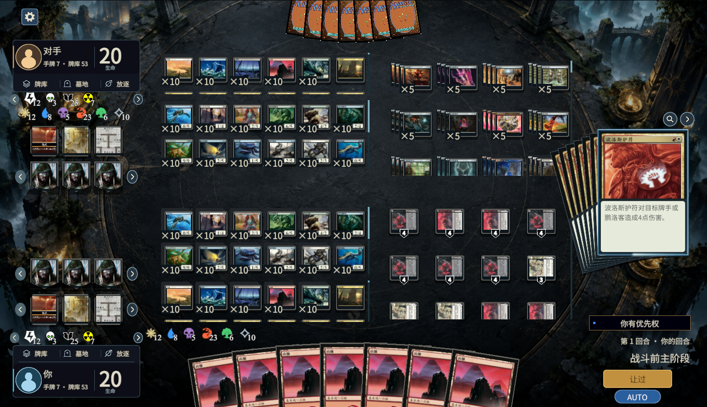
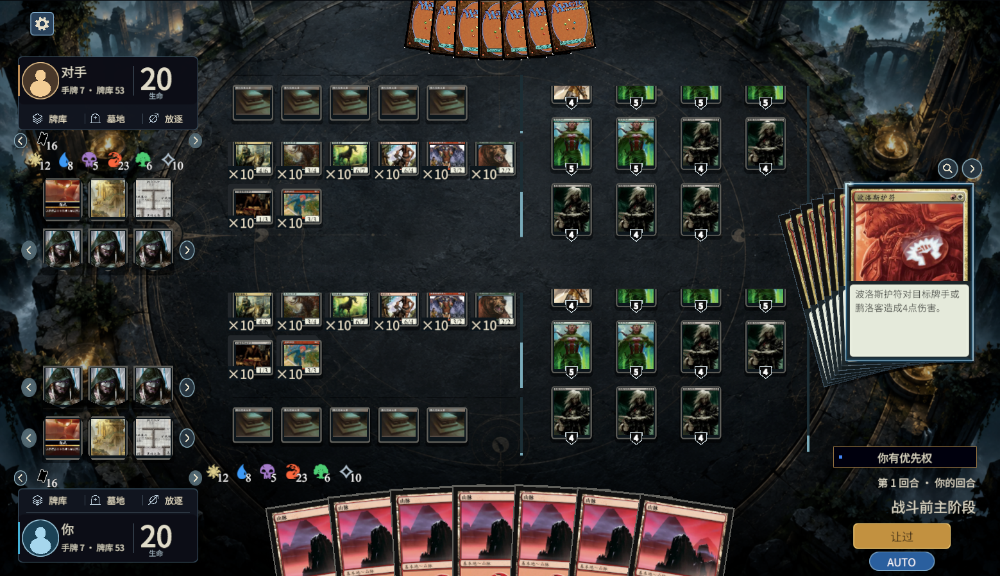
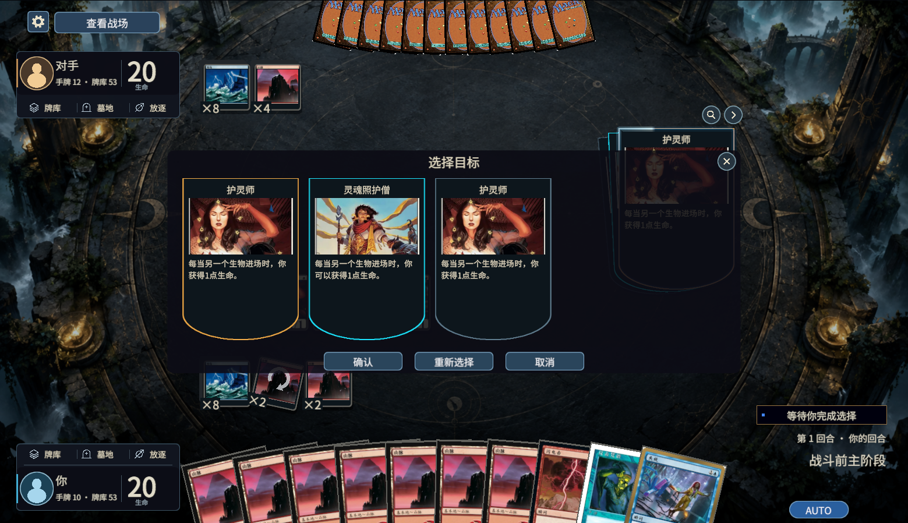

# 玩家指示物、堆叠与密集战场复核 · 2026-10-05

## 截图来源与修正

用户截图来自生产堆叠列表控件。旧检查使用真实 `StackInteractions/triggers-target-2.json` 的护灵师／灵魂照护僧异能，再添加一张不可选、编号为 999999 的显示对象测试三条拥挤边界。因此第三张不亮；新增对象不构成第三个真实规则场景。选择仍使用原生 `stack:<id>`、取消、重选和确认，没有根据卡名推测合法目标。

- 浏览／目标列表的异能外框现在使用与右侧堆叠一致的弧形底部，修正旧矩形彩色底板露出的情况。
- 所有异能牌面的正文共用固定字号、符号渲染及有遮罩的滚动区域。此前只有替代效果采用该处理，普通触发／起动异能的符号文字可能越框。
- 能唯一对应未修改印刷规则段落的普通异能也使用既有译文；动态或不匹配文字保留原生描述，不猜译文。
- 玩家指示物使用裸图标、白色衬线数字、与法术力相同的右下数字位置和按数值宽度紧凑排列。能量使用本地 Mana 字体的 e907，其他四种沿用本地 Forge 图标；没有放入法术力池。四种一页，超出翻页。
- 满法术力池的本方位置按宽度保持在指示物翻页按钮右侧，付款身份与公开池权限不变。

## 每方压力数量

| 类型 | 不同名字 | 每种数量 | 实际对象数 |
|---|---:|---:|---:|
| 生物 | 20 | 10 | 200 |
| 地 | 20 | 10 | 200 |
| 神器 | 10 | 5 | 50 |
| 结界 | 10 | 5 | 50 |
| 鹏洛客 | 10 | 5 | 50 |
| 战役 | 5 | 5 | 25 |
| 合计 | 75 | — | 575 |

双方合计 **1150** 个准确不同编号的永久物。数量压力夹具在真实快照的结构上扩展已有本地牌定义，不是这些牌实际施放、传奇规则或效果结算证据。二十种生物选择不同的无规则文字生物，地包含五种基本地和十五种非基本地；神器／结界的安全叠放标志明确属于没有逐对象关联状态的布局适配器。没有放宽生产桥接的安全叠放判定，也没有强行叠放鹏洛客、战役或非基本地。

放不下时，生物、地和支持永久物分别在所属玩家半场内滚动，保留可读卡牌尺寸、原始编号与原有展开逻辑，避免跨半场排列或压成一排细条。每种玩家指示物均存在：能量、中毒、经验、辐射、票券；第一张截图显示前四种，第二张显示票券页。状态、徽记、延迟与七条堆叠仍沿用已有控件。

## 增量证据

范围限定为 **1560×898、1.3 倍字号**。没有重跑全机制 goal，没有新增 Forge 规则测试；goal 保持暂停。图证据标为 metadata_changed，相关实现和调用者已直接读取；不据此作全项目完整性结论。

| 检查 | 本轮结果及范围 |
|---|---|
| `BattlefieldStressPresentationValidation` | 中／英／日；真实异能加明确的长文本适配器，正文滚动末端、外框形状及查看／返回；五种指示物、字体／图标、分页；每方575编号、代表数量合计575、六个溢出区域末对象可达及真实悬停射线、刷新保留滚动、密集恢复普通布局。 |
| `StackListPresentationValidation` | 中／英／日；原生目标编号、读写权限、取消／重选／确认、符号、扇形、收起、浏览与末对象。 |
| `ManaResultPresentationValidation.RunPoolOnly` | 中／英／日；真实手动付款／重试／操控释放、颜色编号及旧请求／重复／观战守卫，六种池量与边界。 |
| `DuelLayoutPresentationValidation` | 中／英／日；玩家目标射线、标记分页／身份、固定阶段字号、区域层级及查看／返回。 |
| `DamageDrawPresentationValidation`、`ReplacementPresentationValidation` | 中／英／日；共用替代异能牌面的原生身份、完整正文／符号、实际滚动末端、顺序／可选确认与取消、旧／重复／非操作守卫。 |
| `ForgeInteractionValidation` | 原生菜单取消、异能目标来源、确认／重选、堆叠牌面边界／插画／悬停退出与辉光，以及已有列表实例／滚动保留；该旧套未宣称三语言。 |

结果、输入快照、源码哈希与解码截图归档于 `.tools/battlefield-stress-1005/`。同一任务的前三套在随后仅修改其他测试驱动时保留通过身份，没有为无关测试修改重复运行生产控件。原始失败分别存放在 `attempts/`；先前任务的原始源码归档保持原批次身份。

## 失败与方法修正

1. 最初长文本夹具重复了 Forge 的行尾 Zone Changer 调试描述，清理逻辑截成短文本。夹具改为只重复实际效果正文，未修改规则。
2. 新滚动内容以顶部为原点，卡牌沿用普通战场的中心锚，导致末对象不可达。修正密集内容的顶部锚，回普通战场时恢复中心锚。
3. 能量文本新建偏好组件时首帧替换了字体。绑定 KeepFont 后再次赋正确矢量字体，并增加字体身份检查。
4. 日文发掘正文实际 TMP 高147.7，内容高153.7，禁用 legacy Text 却报161.91。旧检查测错组件，改为实际显示 TMP 的格式化全文、固定字号和完整高度断言；不是减弱为只检查对象存在。相关 skill 增加此反例及密集边界，`quick_validate.py` 通过。
5. 旧来源／堆叠检查仍查找已移入滚动区的 Effect 路径，并在0.15秒悬停关闭延迟前立刻断言。更新准确路径和有界等待，并明确鼠标在详情框外。

尚未验证任意分辨率、实际1150对象网络对局、密集攻击／阻挡拖动、所有逐对象关联状态、所有未知长动态描述、四人指挥官以及全部玩家指示物规则组合。当前证据只支持上述布局及原生快照交互。

## 最终 Unity 画面

