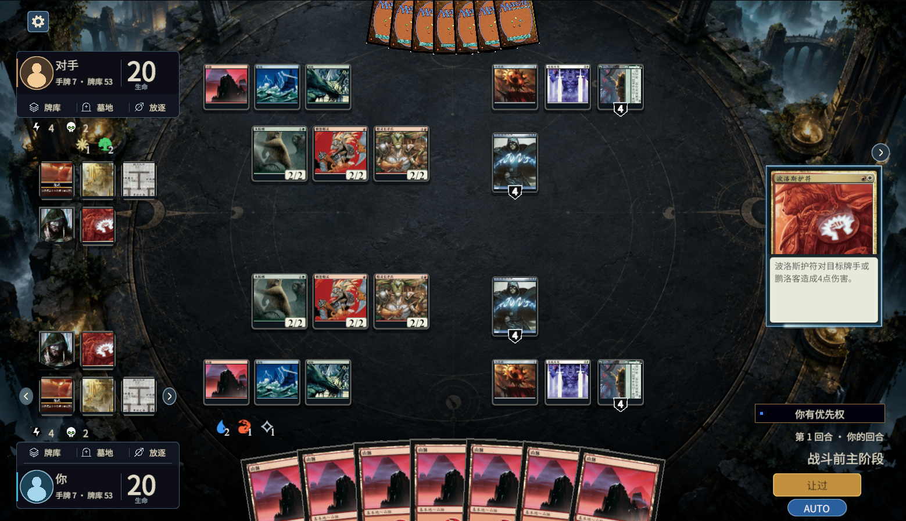
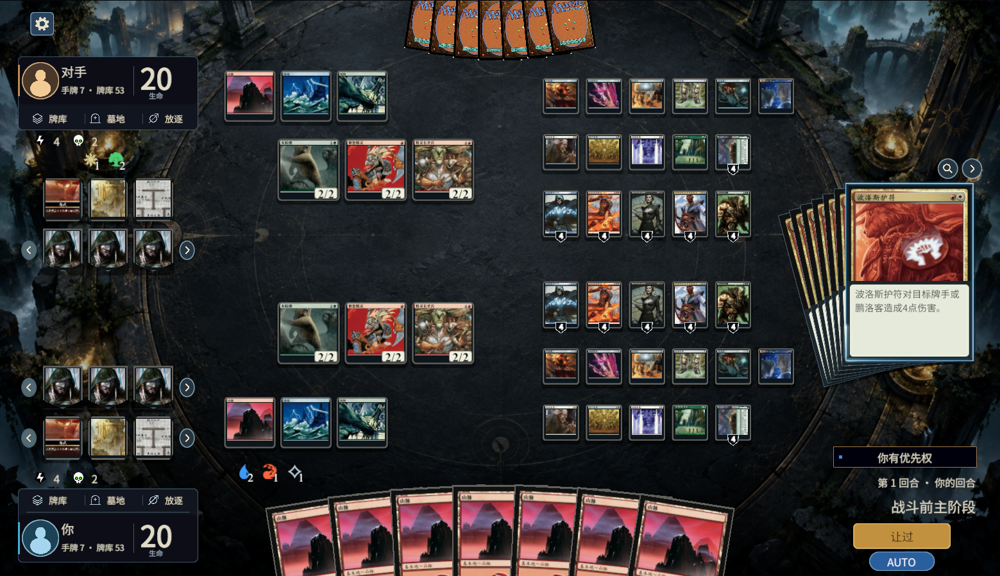

# 1v1 战场布局接入 · 2026-10-05

## 本轮范围

按 HTML 方案 A 的排版修改生产 `IntegratedBattlefield` 场景与运行时 uGUI。双方资料集中到左侧各自半场，右侧保留堆叠与阶段操作。现有状态辅助图、徽记盾形、延迟效果六角形、卡牌详情、堆叠扇形和模式正文继续复用；头像缺少玩家自选素材时使用不依赖字体的中性人像。

- 自己的区域栏、指示物、状态和徽记在头像上方；对方对应内容在头像下方。
- 状态和徽记／持续／延迟效果分别一行三个，独立翻页；按真实玩家席位与原生对象编号保留身份。昼夜只加入本地状态行一次。
- 玩家指示物读取现有 Forge 字段和本地图标，一行最多四种，超出翻页。未知图标保留类型文字，不丢弃真实数量。
- 法术力池保留裸符号与白色数字。原操作池继续绑定原生合法支付选项，随操控玩家切换位置；另一玩家池显示公开数量且不可点击。
- 回合数和行动玩家合到阶段上方。主操作改为较小的暖金按钮；AUTO 改成短胶囊，保持 On／Off／Auto 原有三态策略，固定字号。
- 正常房间编号不再占阶段信息行；真实断线重连与提交状态继续显示在现有优先权位置。重连文案的三语言检查属于展示适配检查，没有冒充真实网络测试。
- 既有结果记录改成左侧窄抽屉，仍仅显示视图已提供的结果；没有新增完整施放／区域移动历史。查看战场和返回选择仍在设置旁。
- 神器、结界、鹏洛客及战役继续使用已有永久物展示；调整支持区列数，密集局面保留所有卡牌并允许悬停查看。

真实动作、目标、支付及堆叠仍由 Forge 选项决定。没有修改 Forge 规则、牌库资料、翻译或卡图，也没有开始四人指挥官接入；原全机制 goal 保持暂停。

## 验证与边界

使用机制验证 skill 按影响选择 UI 回归，没有重跑全部引擎效果场景。覆盖清单在修改前后刷新；刷新属于分类更新，不是规则结算证据。

| 检查 | 本轮证据 | 断言范围 |
|---|---|---|
| `ManaResultPresentationValidation.RunPoolOnly()` | `.tools/battlefield-layout-1005/mana-passed/result.txt` | 中／英／日；原生支付、付款重试、操控／释放、准确颜色选项、射线、旧请求／重复／观战拦截；数字和符号、空池、增长反馈、屏幕边界与操作区不相交 |
| `StackListPresentationValidation.Run()` | `.tools/battlefield-layout-1005/stack-list-passed/result.txt` | 中／英／日；0／1／2／3／7 条布局、收起动画、只读横向浏览、原生堆叠目标、取消／确认／重置及查看战场恢复 |
| `DuelLayoutPresentationValidation.Run()` | `.tools/battlefield-layout-1005/ui/result.txt` | 中／英／日；两个席位的原生玩家选择射线；头像网格、区域栏层级、状态／徽记独立分页和稳定身份；固定阶段／AUTO 字号、标题高度与窗口隐藏／返回 |
| 左侧抽屉与区域窗口补查 | `.tools/battlefield-layout-1005/ui/panels-result.txt` | 三语言原生结果记录实际射线打开／关闭；抽屉宽度、滚动位置恢复；非公开牌库入口只显示允许的数量说明并能隐藏／返回 |

混合密集夹具每人实际创建 3 个不同生物、5 种神器、5 种结界、5 位鹏洛客、1 个战役、3 种地。验证所有永久物对象存在并处于战场边界内；七条堆叠、额外徽记和延迟效果明确属于布局压力数据，不当作这些牌的效果验证。普通和密集截图均来自生产 Unity UI 的编辑器夹具。

采样分辨率为 **1560×898**，保留用户现有 **1.3 倍字号**。未宣称全部窗口尺寸、所有长名字／长卡文、任意密集数量或真实网络时序通过。结果记录仍是现有有界通知，不是完整对局历史。

## 修复中发现的问题

1. 堆叠目标列表遮住查看图标：仅在拥挤目标选择时抬高该堆叠控件；原生目标与只读浏览回归通过。早期失败保存在 `attempts/stack-control-blocked.txt`。
2. 已存在于前面的底板移动到目标索引时，删除原位置导致索引偏移，重复刷新后盖住区域文字。修正索引，并在分页后的重复展示中断言底板始终位于区域栏之前。
3. 新增人像 Graphic 需要 CanvasRenderer。补上显式依赖，并断言实际渲染网格，避免只验证 GameObject 存在。
4. 1.3 倍字号下阶段／回合文字的首选高度大于容器高度。增高容器并分开上下控件；对方池与指示物／状态的间隔另行调整。只重测受影响的布局和池位置。

旧批次与失败记录保留，当前输入、来源哈希和截图解码结果见 `.tools/battlefield-layout-1005/manifest.json`。未把先前整批 PASS 复制为本轮全机制通过。

## 最终画面

