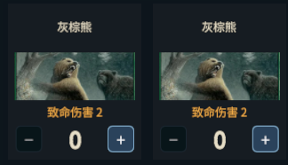
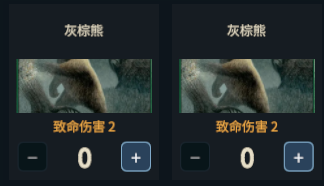
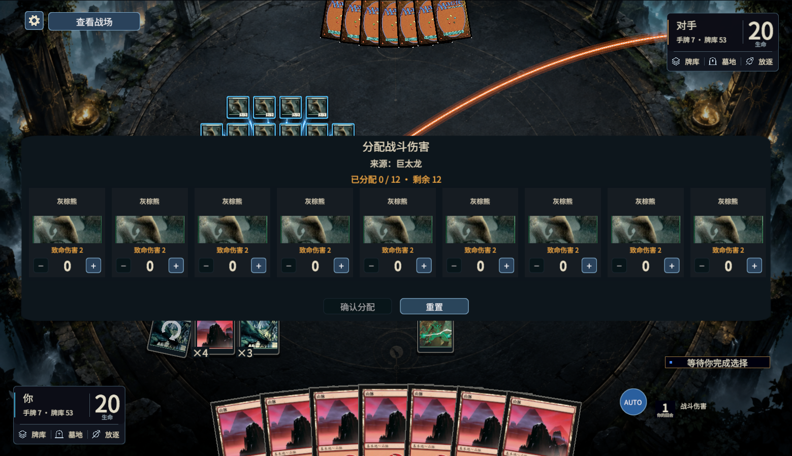

# 选择窗口图片比例复核

## 后续构图调整：从插画顶部往下裁切

用户指出居中裁切只剩插画中间。`Illustration` 现改为插画上沿对齐、水平居中、等比例填满，沿用原图框；牌头的居中策略保持独立。原插画范围的上沿为整张牌高的 81%，灰棕熊截图仍丢失头顶；与实际使用的中文 10E/268 卡图核对后上移到 88%（插画顶部、牌名下方），下沿仍为 43%。这是一套常规卡框的裁切范围，不声称所有特殊卡框都已识别。

新增证据独立归档在 `.tools/choice-art-top-review-1004/`；先前居中裁切的结果保留在 `.tools/choice-art-review-1004/`。第一次仅改变对齐、尚未上移区域的数学／交互结果和截图保留在 `attempt-1-low-region/`，它们比例正确但构图未达到本次要求。

只重跑受影响的 `ChoiceArtAspectValidation`：32 组数学边界直接调用插画／牌头入口，分别断言上沿保留与居中；三语言 × 10 个原生请求状态，33 张截图及 87 次实际比例采样，包含分配点击、末对象滚动、查看战场／返回。既有模式回归是下面的历史证据，本次牌头没有改变，不重复运行；新增引擎效果场景为 0，原 goal 保持暂停。

## 原因与改动

伤害分配中的插画框为 166×66，而截取的卡图区域是牌宽的 86% 与牌高的 38%，两者宽高比不同。`RawImage` 直接铺满框，导致图片横向拉宽、看起来压扁。原检查只确认图片存在、文字边界和点击合同，没有检查插画像素与显示框的比例。

新增共用 `CardArtCrop`：在指定插画／上半牌面区域内等比例居中裁切，保持原图框和控件布局；包含上级非等比缩放的实际显示比例。支持 sprite 子区域，缺图时清除旧纹理与 UV，不额外读取／修改卡图。

六处接入：伤害／数量分配、异能牌面、普通异能／施放方式选项、备法牌面、模式选择牌头、堆叠中已选咒语牌头。裁切不越过指定卡图区域，不露出被替换的规则文字。其他完整牌面已经使用 Image.preserveAspect，未改其展示。

## 首次比例修复的历史证据

本轮仅 Unity 图片展示修改，复用归档的原生请求，新增引擎效果场景为 **0**；暂停的机制 goal 没有恢复。

| 检查 | 实际通过范围 |
|---|---|
| `ChoiceArtAspectValidation` 数学边界 | 32 组：宽／高图框、sprite 子区域、两种卡图区域、上级非等比缩放与旋转；像素宽高比等于实际显示比、裁切居中、最大保留面积、区域边界、缺图清理 |
| 真实请求展示重放 | 中英日三语言 × 10 个窗口／状态，33 张截图、88 次实际图片比例采样；11 个受伤对象、小量战斗分配、咒语伤害分配、历险施放选项、备法支付／堆叠、异能堆叠／排序、追欢模式和已选咒语牌面 |
| 分配交互 | 精确原生增／减选项的真实射线点击，旧编号／重复／非操作玩家拦截，同请求保留图片控件与裁切、查看战场／返回、横向末对象可达 |
| `ModeCardPresentationValidation` | 三语言的模式、追欢及可选费用请求；裁切边界、遮挡、正文完整、原始模式身份、选择门槛、真实点击及取消合同 |
| 登记与方法 | `choice-art-aspect` 展示任务已登记，实际输入的引擎依赖包含 casting；登记框架 6 项与 skill 格式检查通过 |

采样为 1559×898 编辑器画面、当前文字比例 1.3。图比检查不证明所有卡图构图、所有分辨率或实时网络已验证；三语言采样也不代表这些归档请求的全部文本翻译均已重新复核。

第一次检查在独立重放备法 payment 时没有可见备法牌面：驱动遗漏了 ready 请求与施放点击留下的 castingCardId。补齐真实前置顺序后通过，原失败保留在 `.tools/choice-art-review-1004/attempt-1/`；未将驱动遗漏算为图片产品缺陷。

输入、源码与 SHA-256、用户原截图、比例观测、最终截图、失败和相关模式回归归档在 `.tools/choice-art-review-1004/`。图服务返回 `Transport closed`，使用精确源文件回退；局部展示通过不覆盖工具中其他测试的失效状态。

## 截图

