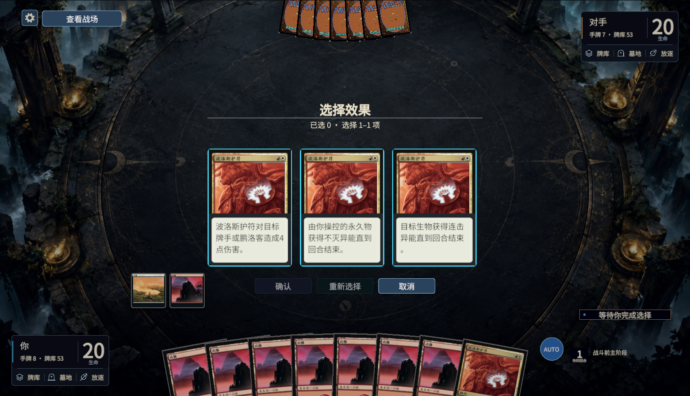
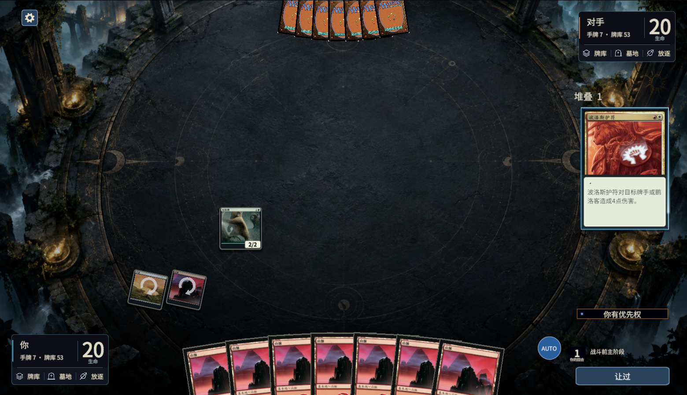

# 战场按钮与堆叠施放选择

## 当前行为

- “查看战场／返回选择／离开战场”使用设置右侧的同一个位置，根据当前状态显示，查看按钮不再跟随窗口移动。“离开战场”沿用原来结束后查看／离开流程。
- 普通操作按钮使用不透明蓝灰底、浅色边缘和明亮文字，悬停、按下、禁用分别反馈。设置、优先权按钮、程序生成的选择按钮及 ReplayWidgets 共用样式；卡牌、头像、裸法术力图标保留各自表现。
- 堆叠咒语读取 Forge 已确定的模式、可选／替代费用及关键词追加次数。模式牌面保留卡名与插画，下半部仅显示实际选中的效果；追加／替代方式标在牌面内。悬停预览使用同一份选定牌面。普通施放不增加未支付费用的标记。
- 规则正文固定字号，超过牌面可用高度时滚动；不依靠缩字号挤入。切换状态／席位会关闭旧悬停详情。

## 取数与翻译

原生 `CharmEffect.chainAbilities` 复制选中的模式进入 subability 链，`getChosenList` 不是这里的确定结果，`CharmOrder` 还会重编号。桥接读取实际链，按原始 `Choices` 的 API、SpellDescription、ModeCost 唯一匹配原规则行；因此过滤掉前两项后，第三项仍按第三行翻译。歧义时保留原生描述，不猜译文。

公开字段为 `chosenModes[]` 与 `castingChoices[]`，只用于已上堆叠且非面朝下的咒语。费用直接读取原生 SpellAbility，不把尚可取消的客户端选择当作已支付。费用名称复用本地关键词词库；未知名称仍有回退，不能据此宣称所有机制名称都已本地化。

## 实际引擎验证

`Tools/ForgeBridge/Test-ModeChoices.py` 两批共 **16 个不同实际场景通过**：

| 机制 | 核对 |
|---|---|
| 追欢 | 三项支付／结算；组合费用不足时禁用并拒绝非法提交；只剩原第三项；没有足够费用时取消 |
| 普通模式 | 波洛斯护符选定四点伤害；选择后取消恢复手牌、未横置地、生命、空堆叠及优先权 |
| 增幅 | 电击爆发付／不付追加费用，实际五／一法术力、四／二伤害及原生恢复 |
| 呼魂 | Mulldrifter 呼魂／普通／仅够呼魂；三／五费用、抓二及牺牲／保留 |
| 打包 | One Dozen Eyes 付／不付；九／六费用；两种／一种选定模式；一个 5/5 野兽加五个 1/1 昆虫／仅野兽 |
| 覆诵 | Shattering Spree 追加一次，原咒语与改变目标的复制各消灭一件神器；准确费用、次数和优先权 |
| 繁生 | Tender Wildguide 付／不付；四／二费用；原 2/2 与恰好一个／没有 1/1 衍生复制品 |

每个实际堆叠快照还检查双方公开模式、原始行身份及已支付方式一致。繁生 Offspring 与覆诵 Replicate 是两个不同规则路径。

运行包哈希 `7bf879988cc29a445857e9e250adffc9cfec05b875f7e11c62daa64fdb626d63`，Forge 固定版本未变。14 项批次与后来繁生两项批次保留各自测试／夹具哈希，不合成伪造的单批指纹。前一批源代码从独立新增的繁生分支还原后，与执行时记录的 SHA-256 完全一致，方法单独记录。

## Unity 与相关回归

- `StackChoicePresentationValidation`：十二类真实堆叠快照 × 中／英／日，加三个设置旁按钮场景，39 张截图；核对选中效果、费用译名、普通施放、准确原始序号、本地卡图、固定字号、完整内容高度、滚动、悬停牌面、按钮对比度及 View／Return 真实射线。结束后离开按钮使用独立布局适配器。
- 另用原生第二席位快照检查对手视角，保存一张截图与独立结果。
- 最后增加定向卡图缓存检查：同一个堆叠对象连续切换中／英／日并重复呈现，合成 X 字段与选定模式共存时卡图仍保留。三张截图；X 字段明确属于 UI 适配器，不是实际 X 咒语施放／付款验证。
- `BattlefieldViewPresentationValidation` 相关窗口套再次通过：真实模式／费用／选牌／分堆／排序／分配等输入，隐藏期间不提交、滚动／输入保留、同 context 更新、新决定恢复、席位／空状态恢复、旧请求／重复／非操作玩家保护。通知／调度是 UI 适配器。
- 高排序结束结果窗口单独检查 View／Return 射线与隐藏／恢复，通过；不冒充完整结束对局或网络验证。
- 覆盖工具刷新，框架检查 6 项与展示登记检查 5 项通过，skill 格式检查通过。其余任务保留历史批次与总指纹导致的“需重测”状态，没有改写成当前全量 PASS。

本轮原始轨迹、失败尝试、输入与测试源、截图及 SHA-256 位于 `.tools/stack-choice-proof-1004/`；展示结果位于 `.tools/stack-choice-review-1004/`，构建差异位于 `.tools/stack-choice-package-1004/`。旧列表读取错误、繁生驱动未识别原生 InputConfirm、测试误把覆诵译名当作繁生以及旧详情残留分别保留。

图 MCP 的项目与覆盖调用均返回 `Transport closed`。本轮按上述明确文件及固定 Forge 的 CharmEffect、SpellAbility、OptionalCost／AlternativeCost、GameActionUtil 源码回退；未作图索引完整性或所有调用者覆盖的声明。

未验证：全卡池／所有机制组合、多重追加费用长标签、重复／随机／复制模式、联机时序、其他分辨率及完整结束生命周期。普通额外／替代费用已使用共用字段，但有限样本不证明每个费用机制实际结算都正确。暂停中的总 goal 未恢复。

## 截图

