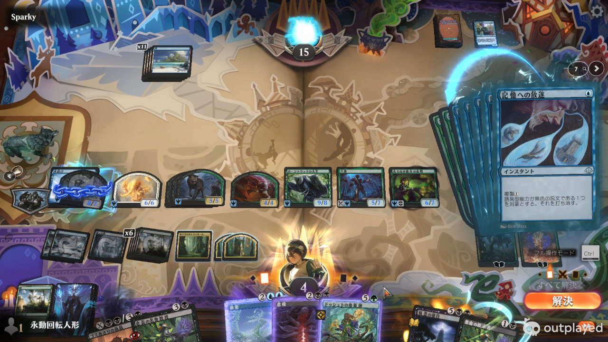
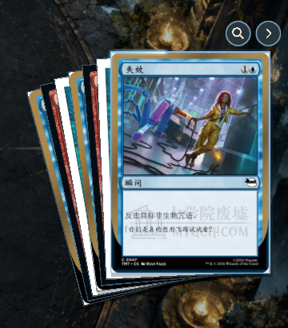
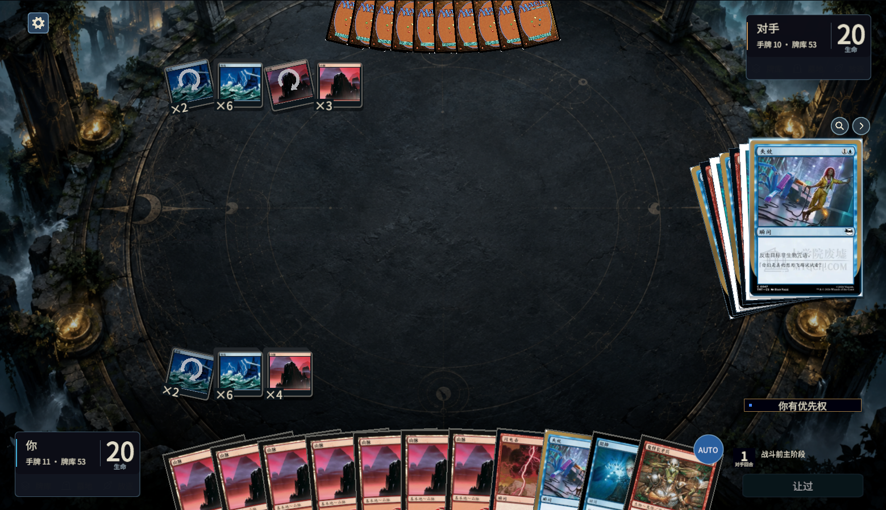
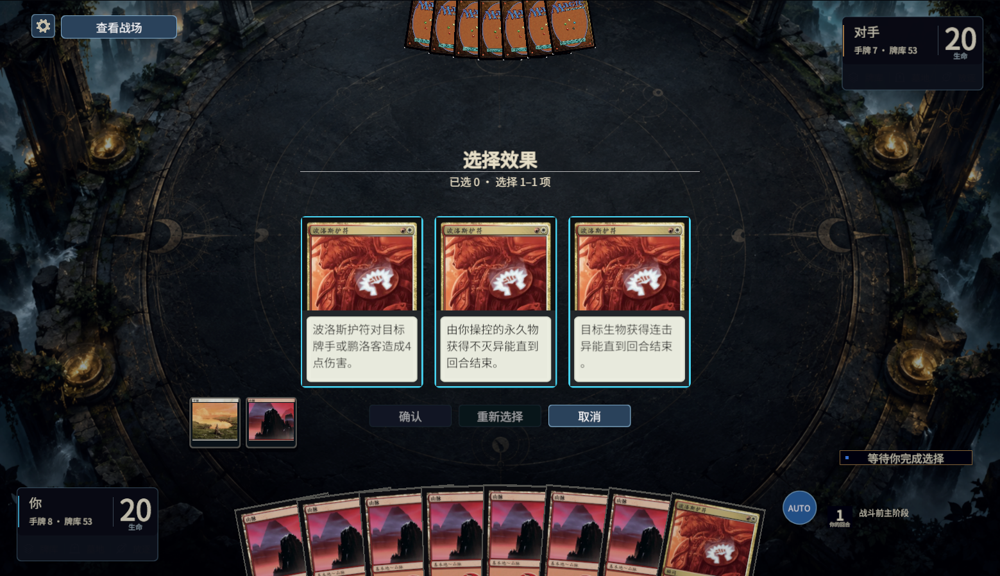

# 多张堆叠排列与窗口字号跳变

## 调整

参考用户截图对应的 `MTG Arena_09-27-2026_7-56-40-333.mp4`，实际提取并查看 **10:46、10:50** 的连续状态。录像来源：`C:/Users/Sam/Videos/Overwolf/Outplayed/MTG Arena/MTG Arena_09-27-2026_7-34-1-962/`。

堆叠改为紧凑扇形：最前一张完整、正向，后面的牌只露出窄边并逐步倾斜。卡牌仍为 240×335 UI 单位；横向展开最多 140、纵向位移最多 36、倾角最多 15°。原排列每张纵向错开 48，数量多时变成长台阶。原生结算顺序、对象身份及三张以上的横向查看／目标列表保留。

字号问题来自两种创建路径：动态文字创建时尚未绑定偏好，每半秒的全局扫描才应用文字缩放；直接改 `fontSize` 又没有更新已经保存的基准，下一次扫描会覆盖它。窗口重新创建会再次经历这一过程。在文字比例 1.3 时，受控复现得到：

| 路径 | 创建／修改瞬间 | 偏好扫描后 |
|---|---:|---:|
| 原路径，名义字号 18 | 18 | 23 |
| 原路径，直接写字号 16 | 16 | 23 |
| 新路径，基准字号 18 | 23 | 23 |
| 新路径，基准改为 16 | 21 | 21 |

`IntegratedUiUtility.Text` 与 `CardSymbolText.Create` 在创建时立即绑定；战场按钮等有意改大小时更新基准字号。法术力图标与数字的专用字体使用 `KeepFont` 保留。隐藏／返回仍使用 CanvasGroup，不注销窗口，不丢失选择或滚动。

## 本次验证

本次只改 Unity 展示，使用归档原生请求。**新增引擎效果场景为 0，暂停的机制 goal 没有恢复。**

| 检查 | 通过范围 |
|---|---|
| `StackFanFontPresentationValidation` | 中英日 × 0.85／1／1.3 字号 × 15 类原生选择窗口，共 135 组；创建瞬间、下一帧、强制及每半秒偏好扫描、两轮隐藏／返回；字号字段与字体对象不变；共用文字工厂首帧正确 |
| 实际渲染字号补充检查 | 三语言的模式、卡牌列表、命名列表，在 1.3 比例首个渲染帧与两轮隐藏／返回后，legacy 最佳适配生成器／TMP 字符点数及实际 transform 缩放不变。其他档位／请求组合的验证是上行字段检查，未混称全部渲染采样 |
| 多张排列 | 1／3／7／12 个堆叠保持完整卡大小、前后顺序及有界角度，每张四个角均位于视口内；超出原生三张快照的数量为显示适配样本 |
| `StackListPresentationValidation` | 三语言：真实射线图标点击、动画中间帧、收起后拦截点击、只读查看不提交、末张可达、滚动保留、合法／非法对象、取消／重选／确认、旧编号／重复／非操作玩家拦截、清空恢复 |
| `BattlefieldViewPresentationValidation` | 原生选择、排序、分配、列表等窗口的真实 View／Return 射线、隐藏期间禁止提交、输入与滚动保留、同 context 更新和新 context 恢复；通知、历史、调度为单独显示适配样本 |
| `ModeCardPresentationValidation` | 三语言的模式、追欢、增幅、呼魂请求；完整规则框、正文高度、原始模式身份、合法性门槛及点击合同 |
| `StackInteractionValidation` | 三张原生堆叠、两张原生目标、前牌与后牌露出窄边的准确点击、箭头、旧／重复编号拦截、触发排序确认、12 张压力及长正文滚动 |
| 登记与 skill | `TestPresentationCoverage.py` 6 项通过；新增 `stack-fan-font` 展示任务；skill 格式检查通过 |

范围为本次 1559×898 编辑器画面和列出的请求、语言及字号。没有声称实时网络、全部分辨率、所有菜单、冷启动语言资源未就绪时的过渡或全卡池机制已经验证。

第一、二次字号套的失败来自驱动把 Clear 后已禁用、等待帧末销毁的旧控件算入新窗口，记录仍保留在 `attempt-1/`、`attempt-2/`。调整为排除旧禁用控件，并在创建新请求前清掉上一请求的延迟销毁；新窗口仍在创建同帧采样，不靠等待热身掩盖首帧变化。最后仅统一了三行数字字体代码的缩进，未改变测试后逻辑。

输入、源码与 SHA-256、录屏帧、字号观测、复现、消费者结果和截图归档在 `.tools/stack-fan-review-1004/`。实际渲染补充驱动为 `rendered-font-probe.cs.txt`，可通过 Unity execute_code 执行。图服务返回 `Transport closed`，改用精确源文件，未声称图覆盖完整。覆盖清单保留工具的自动失效状态，局部展示通过不继承为全量效果通过。

## 画面

录像 10:46：

调整后的七张排列（截图裁切）：

完整场景与窗口返回截图：

