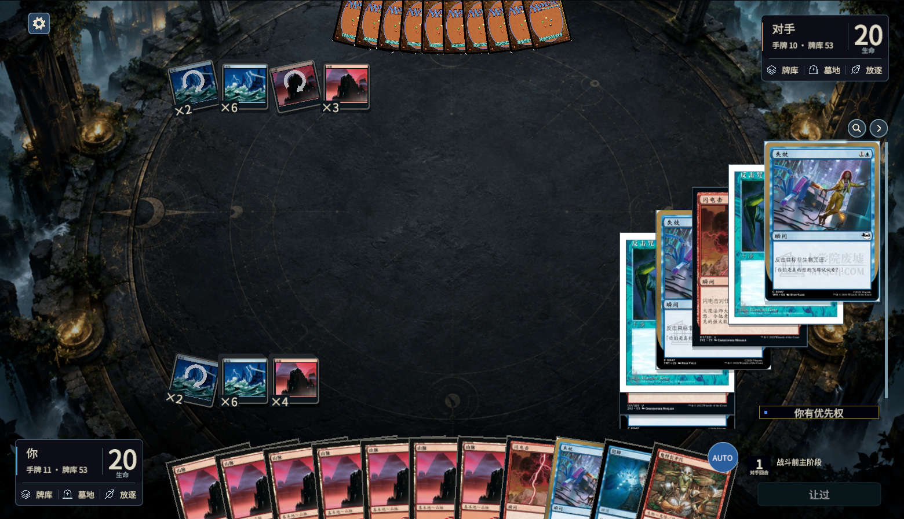
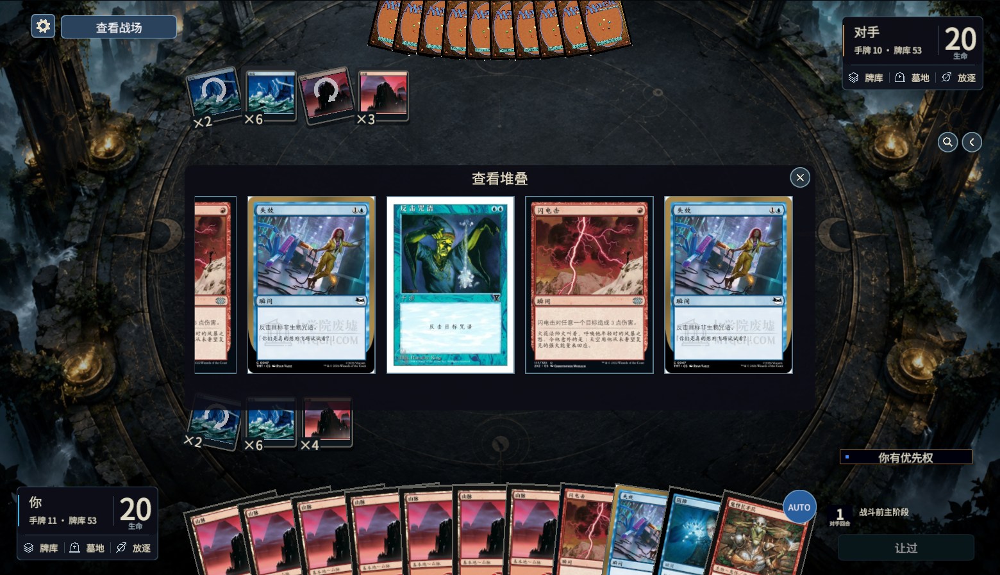
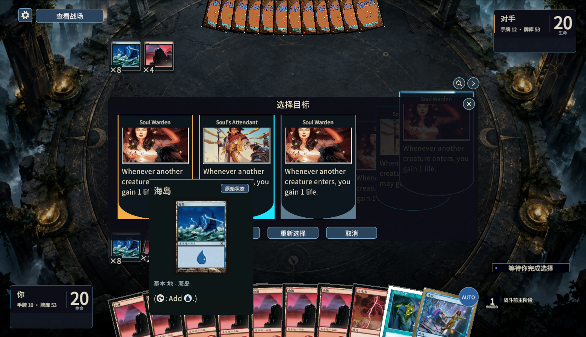
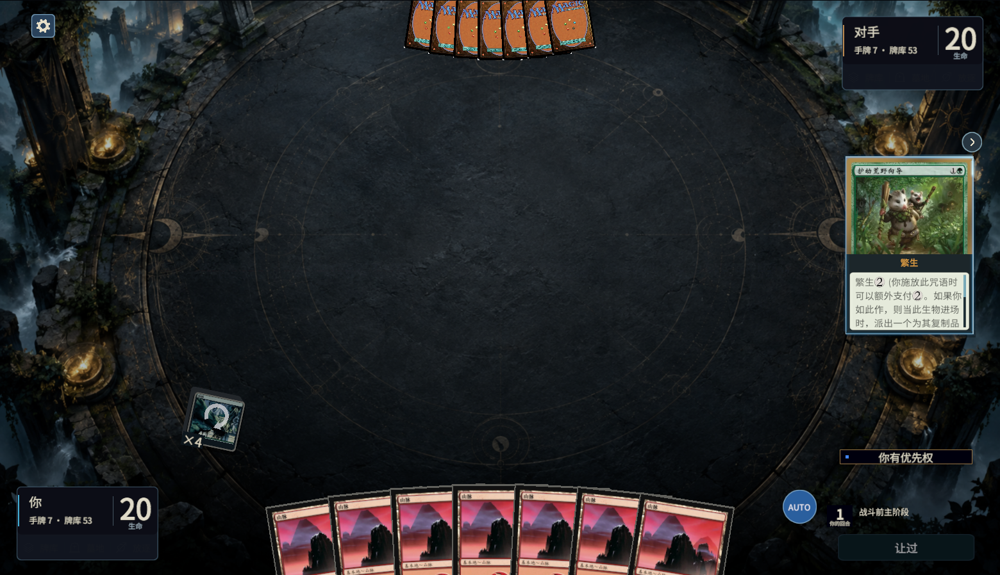

# 堆叠图标、收起与横向查看

## 当前行为

- 去掉侧边栏的“堆叠＋数量”标题。右侧圆形箭头向右滑出全部堆叠牌，变为向左箭头后可以恢复。控件留在原处，收起的牌不能被点击，普通快照更新保留收起状态；堆叠清空时复位。
- 堆叠达到 **3 个**时出现放大镜图标，打开可横向滚动的全部堆叠列表。查看没有提交选项的监听器，卡牌保持正常亮度并可以悬停查看详情。
- 存在原生堆叠目标候选且总数达到 3 个时，自动使用同样的横向列表选择。原生候选可以点击，其余对象禁用；确认、重选、取消使用原始选项身份。关闭列表可以回到战场上的选择。
- 横向列表纳入设置旁的“查看战场／返回选择”，隐藏期间保留滚动位置。新请求上下文与堆叠清空会关闭旧列表。
- 选定咒语正文、费用标题、异能及备法正文复用 `CardSymbolText` 的法术力图标。保留纯文字来源用于语义核对，实际显示由固定字号的 TMP 文字和符号负责；正文溢出可以滚动，文字不会重复缩放。

## 本轮证据

此次只修改 Unity 展示与点击适配，不改 Forge 规则、桥接候选或结算。使用归档的真实请求重放，**没有新增引擎效果场景**。原机制 goal 保持暂停。

| 展示检查 | 实际结果和范围 |
|---|---|
| `StackListPresentationValidation` | 三语言通过，15 张截图；0／1／2／3／7 个对象门槛、图标网格、真实射线点击、动画中间帧、收起后不可点击、横向末张可达、刷新保留滚动、查看不提交、非法／旧编号／重复／非操作玩家拦截、取消／重选／确认、战场查看恢复、结束清理 |
| `CastChoiceFamilyPresentationValidation` | 25 个原生堆叠快照 × 三语言通过，75 张截图；固定字号、完整正文、施放费用次数、选择顺序与原始模式身份、X 和超载已选正文、悬停与卡图 |
| `StackInteractionValidation` | 真实三张堆叠、两张原生目标请求、指定对象点击、箭头、旧／重复请求、触发顺序及 12 张压力和长正文滚动通过 |
| `ReplacementPresentationValidation` | 三语言真实替代请求重放通过；共用异能牌面的完整正文、来源身份、顺序、确认／重选、字体和点击拦截保持正确 |
| 登记框架 | `TestPresentationCoverage.py` 的 6 项检查通过 |

三张目标列表由原生两张目标请求增加一个**没有合法选项**的显示对象构成；七张展示由真实三张快照复制成独立显示编号。它们是布局／非法对象适配检查，不是七次实际施放或三对象原生目标结算。确认与重选选项来自同一原生请求。

符号检查包含繁生、增幅、覆诵、追欢实际堆叠正文，以及异能正文中的 `{2}`、五色、无色、X、横置、双色混血、单色混血和非瑞克西亚符号。检查实际 TMP Sprite 元素数量和完整文字高度，费用减免标题另有显示适配样本。这些样本不代表每一种费用与卡牌组合均已结算验证。

原始输入、SHA-256、受影响源码、失败记录、最终截图和结果：`.tools/stack-list-proof-1004/`。新套失败和被编辑器重载中断的早期尝试另保留在 `.tools/stack-list-ui-1004/attempt-*`，不算通过。当前结论只适用于已检查的三语言、当前字号与 1560×898 画面；实时网络、其他窗口尺寸及全部机制组合仍属未验证范围。

代码图服务的项目和覆盖调用均返回 `Transport closed`，本轮按准确源文件回退检查，未宣称图完整。

## 修复中发现的问题

1. Unity 缺失组件的对象不能依赖 `??` 判断；新增 CanvasGroup 用显式 `== null` 检查后添加。
2. 图标必须有 CanvasRenderer 并检查实际渲染网格，不能仅检查字段；早期空图标截图保留。
3. 只读卡牌禁用 Button 时保留正常颜色，合法性禁用与只读浏览分别处理。
4. 提交后禁用的控件，在同一请求重新显示时必须重新绑定合法状态，不能只依赖牌面缓存键。
5. 新 TMP 的字号已有来源控件缩放时，必须显式绑定基准字号；否则全局偏好扫描会再次乘以字号比例。正文高度检查测量真正的 TMP 渲染器。
6. 首次刷新登记报告将引擎任务误写成不存在的 `modes`，报告返回 KeyError；修正为 `mode-choices`，并新增真实项目登记引用检查，最终报告生成通过。

## 画面

