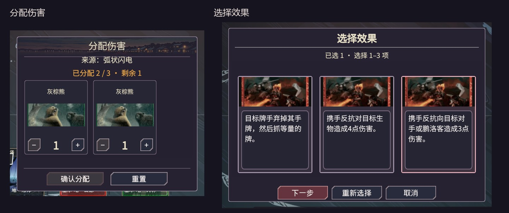

# 新战场界面检查 · 2026-11-21

测试在 Unity Editor 的 Game 视图中进行，分辨率 1920 × 1080，简体中文，文字大小 130%。双人场景为 `IntegratedBattlefield`，四人场景为 `IntegratedBattlefieldCommander4`。用「飘萍皇 · 潮灯」和「月夜秘殿」各复跑了一遍双人决策窗口，结束后恢复了原主题。

## 发现与修正

| 入口或操作 | 复现和处理 | 复测结果 |
| --- | --- | --- |
| 建房、房间列表、房间内、本地人机 | 移除了旧战场选择、房间摘要里的旧标识，以及本地设置预留的行。双人入场直接路由到新版。 | 检查了建房表单和本地设置生成的控件。输入旧房间的 `useLegacyBattlefield=true` 后，配置清洗结果为 false。 |
| 分配伤害、指示物等数量 | 分配窗原来画在排序层 0。牌面挡住了三个样例中的四个可操作按钮，涉及减量、重置和确认。把分配窗和开局决定放入决策层，并沿用引擎给出的禁用状态。 | 两套主题下每套各有 227 个可交互按钮实例至少一个采样点命中，完全被挡住的为 0。开局选先后手的玩家有两个按钮，等待的一方有零个。 |
| 少见的结算窗口 | 模式、选颜色、投票、费用、选地城或门等窗口接入战场主题。页内选项、分页箭头和搜索输入框也跟随主题。 | 实际点选了模式、地城、隔间门、替代／触发排序及费用顺序。牌名和生物类别输入框都取得焦点，光标宽度 3、透明度 1。 |
| 查看战场、认输和局后结算 | 修正结算遮罩的点击拦截。认输二次确认显示期间隐藏后面的设置页。 | 点击查看战场后能回到原来的分配窗口，未提交选择。取消认输回到设置且认输回调次数为 0。结算窗口外命中遮罩；查看战场后可返回结算。 |
| 四人场切换观察席位 | 缓存的上一视角头像栏覆盖另一位对手的状态按钮。按当前观察者和场上玩家隐藏多出的头像栏、牌区；把翻页与统帅入口的点击位置错开。 | 四个视角各有三组对手头像和牌区。12 次状态按钮点击均选择到正确席位。该快照的统帅数都是 0，对应入口均禁用。 |

## 样例与覆盖

- [84 组输入和通知，含样例路径、按钮命中和提交的选项](cases.tsv)。其中 77 组取自既有对局输入快照，6 组单独提取快照中的通知，1 组按桥接协议构造移牌输入。潮灯和秘殿各实际点击了 57 组中的一个按钮，其中 54 次立即产生选项回调。页内操作可以只改变本地选择。
- 这批输入覆盖起手调度、优先权、模式、颜色、投票和秘密投票、数量和伤害分配、费用支付及排序、召集和拼造、移除指示物、增殖、跨区选牌、场上与堆叠目标、占卜、刺探、分堆、触发和替代效应顺序、命名、选择生物类别、地城、隔间、持戒人及统帅确认。通知样例涵盖掷骰、硬币、展示牌、重启和对局所有权相关提示。
- [18 组场面和详情抽查](board-cases.tsv)使用暗置、翻面、备法、玩家控制、持续状态、支付、附着武具、衍生物等场面。记录了实际呈现的头像、对局记录和被打开的卡牌详情。每个样例只检查所列项目。
- 使用攻防输入分别选择攻击者、阻挡者，并验证过期请求不能修改当前选择。阻挡实际返回了 `block:137:136`。对局记录切换历史、状态、双方筛选并收起展开。实际点击放逐区和牌库可以打开查看，空备牌入口禁用。
- 另测了 BO3 局后「前往换备」和换备页读取已保存的 Affinity 卡组（32 个卡牌格）。用于测开局、认输、结算、换备的服务状态由本地验证注入。手动支付区的数字控件另用协议构造的输入检查了透明底板和取消操作。
- 四人测试使用本地归档 `.tools/royal-multiplayer-1010/native/1791590424605219500/100-wire.json` 的四份席位视图。双人主流程使用战场正常的 `Present` 入口。按钮检查通过 Unity EventSystem 对中心及四个偏移位置做射线检测，只计视口内已启用的按钮。每个按钮至少一个采样点能命中就记为可操作。滚动区域外的按钮另列。

## 验证边界

这次验证的是 Unity 呈现、点击目标与提交的选项编号。覆盖清单里的 25 组表现家族用于选取样例，相同窗口还可能被其他卡牌和费用组合触发。完整网络对局、录像导出、每张牌的 Forge 规则结算以及其他语言和分辨率均未在本轮重跑。四人状态入口的检查使用同一场面的四个席位视图。
